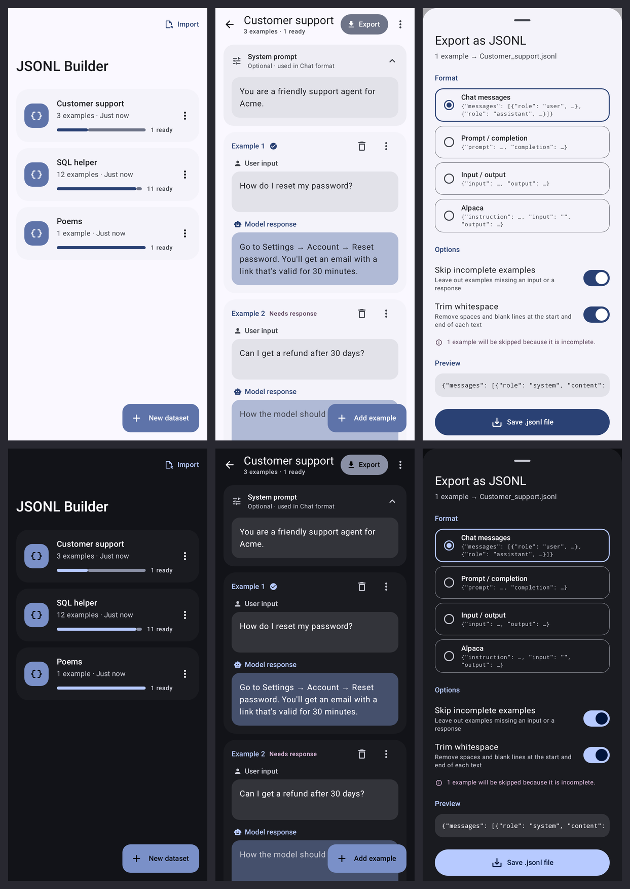

# JSONL Builder

An Android app for writing fine-tuning data on your phone. Type a user input and the model
response you want, add as many examples as you like, and export everything as a `.jsonl` file.



## Install

1. On your phone, open [`dist/JSONL-Builder.apk`](dist/JSONL-Builder.apk) on GitHub and tap
   **Download** (the ⋯ menu / "View raw").
2. Open the downloaded file. If Android asks, allow your browser or file manager to
   **install unknown apps**.
3. Tap **Install**.

Requires Android 8.0 or newer. Later versions install over the old one and keep your data.

## Features

- **Datasets**: keep separate collections (one per project or task), and rename, duplicate or delete them.
- **Examples**: each card has a *User input* and a *Model response*. Tap **Add example** for the
  next one. Each card's ⋯ menu can duplicate it or move it up or down. Deleting has an **Undo**.
- **Auto-save**: everything is saved to the phone's storage as you type, and any pending edit
  is written the moment you leave the app, so closing or swiping it away loses nothing.
- **System prompt** (optional) per dataset, added to every example in the Chat format.
- **Export** as `.jsonl` (one JSON object per line):
  - **Chat messages**: `{"messages": [{"role": "system", …}, {"role": "user", …}, {"role": "assistant", …}]}`.
    This is the format OpenAI fine-tuning, Hugging Face TRL, Unsloth and most other tools expect.
  - **Prompt / completion**: `{"prompt": …, "completion": …}`
  - **Input / output**: `{"input": …, "output": …}`
  - **Alpaca**: `{"instruction": …, "input": "", "output": …}`

  Save the file anywhere (Downloads, Drive…), share it to another app, or copy it to the
  clipboard. Incomplete examples are skipped and whitespace is trimmed by default (both
  can be switched off).
- **Import** a `.jsonl` file in any of the formats above (or ShareGPT `conversations`) to keep
  editing it. This also works as a backup and restore.
- Material 3 design with light/dark mode, using your wallpaper colours on Android 12+.

## Build from source

Needs JDK 17+ and the Android SDK (platform 36).

```sh
./gradlew assembleRelease    # → app/build/outputs/apk/release/app-release.apk
./gradlew testDebugUnitTest  # unit + Robolectric UI tests; screenshots in app/build/screenshots/
```

Release builds are signed with `app/release.keystore`, which is committed on purpose so
every build can update an installed copy without wiping its data. It's a personal sideload
key, not a Play Store key.
