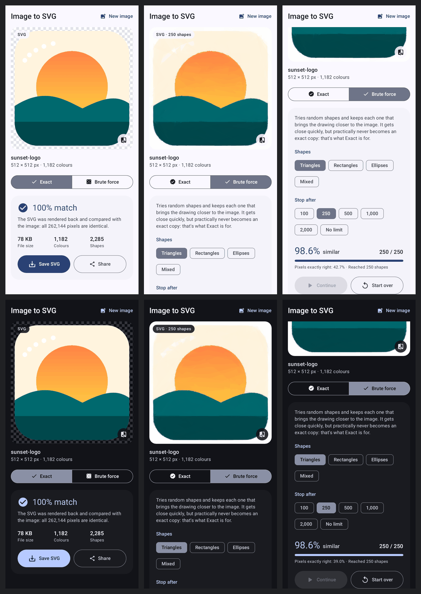

# Image to SVG

An Android app that turns any image (PNG, JPEG, WebP, GIF, HEIC…) into an `.svg` file.
It has two modes:

- **Exact**: an SVG that matches the image 100%, pixel for pixel. The app proves it by
  rendering the SVG back and comparing every pixel with the original.
- **Brute force**: throws random shapes at the picture and keeps each one that brings it
  closer, live on screen. Small, artistic files, but practically never exact.



## Install

1. On your phone, open [`dist/Image-to-SVG.apk`](dist/Image-to-SVG.apk) on GitHub and tap
   **Download** (the ⋯ menu / "View raw").
2. Open the downloaded file. If Android asks, allow your browser or file manager to
   **install unknown apps**.
3. Tap **Install**.

Requires Android 8.0 or newer. You can also **Share** an image from your gallery or file
manager straight into the app.

## Why "brute force until it matches exactly" doesn't work, and what does

Brute force means guessing shapes, scoring how close the drawing is, and keeping the
guesses that help. It gets *close* fast (the logo in the screenshots is 98.6% similar after
250 triangles), but it essentially never gets to *exact*. Each shape changes a whole patch of pixels at once,
so fixing the last few colour levels of one pixel without disturbing its neighbours ends up
needing roughly one perfectly placed shape per pixel, found by luck. A 1000×1000 image has a
million pixels with 16.7 million possible colours each. Random search would not finish in any
amount of time you'd wait. The app's brute-force mode shows this live: "similar" climbs into
the high 90s while "pixels exactly right" stays far from 100%.

There's no need to search at all, because an exact answer can be built directly:

1. Group pixels that have the same colour and touch each other into regions.
2. Trace the outline of every region (and of every hole inside it) along the pixel edges.
3. Write each outline as an SVG `<path>` using only horizontal and vertical lines on whole
   pixel coordinates, one `<path>` per colour.

Every pixel ends up covered by exactly one shape of exactly its own colour, so the SVG
**is** the image: 100% accurate by construction, in well under a second for typical images.
Semi-transparent pixels keep their transparency (`fill-opacity`), and fully transparent
pixels are simply left out. After writing the file, the app parses it back, rasterises it
and compares all pixels, then shows **100% match** only if every one is identical.

The catch is honesty about what "exact" means for a raster image:

- **It's still pixels.** Zoom into the SVG and you see the original pixels as crisp squares.
  No converter can produce smooth curves that also reproduce every antialiased pixel
  exactly; smooth-curve tracers (Potrace, Inkscape's Trace Bitmap, Illustrator's Image
  Trace) look nicer when zoomed but are approximations.
- **File size depends on the number of colours.** Logos, icons, screenshots, UI mockups and
  pixel art give small files (the 512×512 logo in the screenshots, with 1,182 colours, is
  78 KB). Photos, especially JPEGs, have a slightly different colour on almost every pixel,
  so an exact SVG of a photo is huge (roughly 40 bytes per pixel, so ~500 MB for a 12 MP
  photo). The app estimates the size up front and asks before making anything bigger than
  25 MB.

For a small *approximate* SVG of a photo, use brute force (or a smooth tracer). For an
*exact* SVG, use Exact.

## Features

- **Exact mode**: lossless conversion as described above, with a pixel-by-pixel check of
  the saved file, plus file size, colour count and shape count.
- **Brute force mode**: hill-climbing search over random **triangles**, **rectangles**,
  **ellipses** or a **mix** (the approach of Michael Fogleman's *primitive*), using all CPU
  cores. Stop after 100 to 2,000 shapes or let it run. You can stop, continue, or start
  over at any time.
- **Preview**: pinch to zoom (pixels stay sharp), double-tap to reset, and hold the
  compare button to flip to the original.
- **Save** the `.svg` anywhere (Downloads, Drive…) or **share** it to another app.
- Material 3 design with light/dark mode, using your wallpaper colours on Android 12+.

## Build from source

This folder is a self-contained Gradle project. Needs JDK 17+ and the Android SDK
(platform 36).

```sh
cd imagetosvg
./gradlew assembleRelease    # → app/build/outputs/apk/release/app-release.apk
./gradlew testDebugUnitTest  # unit + Robolectric UI tests; screenshots in app/build/screenshots/
```

The tests convert hundreds of random images (holes, islands, diagonal touches,
transparency) and check each SVG with two independent renderers. During development the
SVGs were also rendered in Chromium, which drew them pixel-identical to the original PNGs.

Release builds are signed with `app/release.keystore` (alias and passwords `imagetosvg`),
committed on purpose so every build can be installed over the previous one. It's a personal
sideload key, not a Play Store key.
